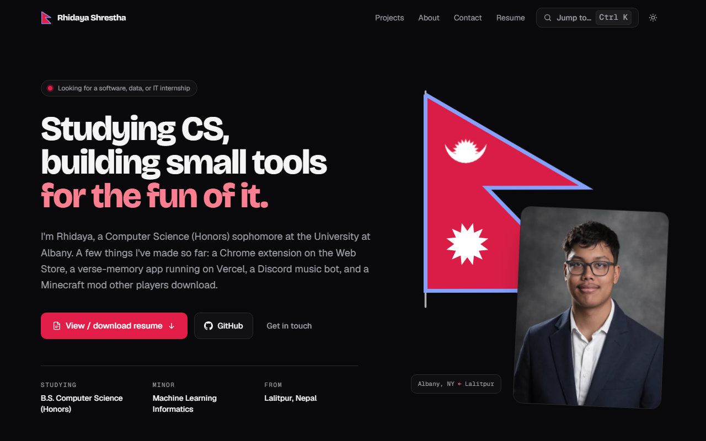

<div align="center">

# Rhidaya Shrestha · Portfolio

**Projects, a printable resume, and a contact form. Plain HTML, Tailwind via CDN, and a little vanilla JavaScript.**

[](https://potat4190.github.io/ProjectsDisplay/)
[](https://github.com/potat4190/ProjectsDisplay/actions/workflows/deploy.yml)

</div>

<br />



## What's here

- **`index.html`**: the portfolio. Hero, filterable project grid, about with a timeline, and a contact form.
- **`resume.html`**: a resume page that matches the site and prints to a single US Letter page. Its "Download PDF" button opens the browser's print dialog (choose *Save as PDF*).

Small details worth knowing about:

- Press <kbd>Ctrl</kbd>/<kbd>⌘</kbd> + <kbd>K</kbd> (or <kbd>/</kbd>) to jump to any section or project.
- The theme toggle remembers your choice and otherwise follows your OS.
- Going between the two pages uses cross-document View Transitions in browsers that support them.
- With `prefers-reduced-motion` set, every animation turns off and the content still shows.

## Project structure

```
ProjectsDisplay/
├── index.html                 # portfolio
├── resume.html                # resume (screen + print)
├── assets/
│   ├── css/site.css           # design tokens, motion, components
│   ├── css/resume.css         # resume sheet + print rules
│   ├── js/tailwind.config.js  # shared Tailwind CDN config (colors → CSS variables)
│   ├── js/main.js             # theme, reveals, filter, ⌘K, form, copy-to-clipboard
│   └── img/                   # favicon, photos/, projects/ (only what the site loads)
├── _source/                   # original photos and screenshots, not deployed
├── docs/DESIGN.md             # design system
└── .github/
    ├── workflows/deploy.yml   # GitHub Pages deploy on push to main
    └── scripts/check-links.sh # fails the build on missing files or /absolute paths
```

Every asset is referenced with a `./relative` path so the site works under `/ProjectsDisplay/` on GitHub Pages.

## Contact form (Formspree)

The form posts to Formspree form `maeqajno` (`https://formspree.io/f/maeqajno`), which delivers to **rhidayash@gmail.com**.

- `assets/js/main.js` validates the fields, then submits with `fetch` and `Accept: application/json`. The page doesn't reload:
  success and error messages (including Formspree's own `errors[]`) appear under the button.
- Fields sent: `name`, `email` (Formspree uses it as the reply-to), `topic`, `message`, plus `_subject` for the email subject line
  and `_gotcha`, a hidden honeypot that Formspree uses to drop spam.
- To switch forms, change the `action` on `#contactForm` in `index.html`. If the action ever contains `YOUR_FORM_ID`,
  the form tells visitors to use LinkedIn instead of failing silently.

## Deployment

`.github/workflows/deploy.yml` runs on every push to `main` (and manually from the Actions tab):

1. checks every local `src`/`href`/`srcset` in both pages and every `url()` in the CSS,
2. copies only `index.html`, `resume.html` and `assets/` into `_site/`,
3. uploads `_site` and deploys it to GitHub Pages.

**One-time setup:** repo **Settings → Pages → Build and deployment → Source: GitHub Actions**.

## Running locally

No build step. Serve the folder with any static server so relative paths behave like production:

```bash
python -m http.server 8080
```

Then open http://localhost:8080. To run the same link check CI runs:

```bash
bash .github/scripts/check-links.sh index.html resume.html
```

## Editing content

- **Projects** are `<article class="card">` blocks in `#projectGrid`. `data-tags` drives the filter (`python`, `java`, `js`, `live`),
  and `data-title` is the name shown in the ⌘K menu. Big cards use `lg:col-span-3` and small ones use `lg:col-span-2`.
- **Screenshots** go in `assets/img/projects/`. Keep the original in `_source/`.
- **Resume** content lives directly in `resume.html`. After editing, print-preview it to check it still fits on one page.

## Contact

[LinkedIn](https://www.linkedin.com/in/rhidaya-shrestha/) · Discord `potat.4190` · [GitHub](https://github.com/potat4190)
